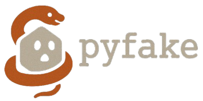

<p align="center">
  <a href="https://github.com/Mukhopadhyay/pyfake">
    
  </a>
</p>


<p align="center">
  <i>A flexible, schema-driven fake data generator built on top of <b>Pydantic v2</b>.</i>
</p>

<p align="center">
  <a href="https://pypi.org/project/pyfake/">
    
  </a>
  <a href="https://github.com/Mukhopadhyay/pyfake/actions/workflows/test.yml">
    
  </a>
  
  
  
</p>


<p align="center">
  <a href="https://mukhopadhyay.is-a.dev/pyfake/"><strong>Documentation</strong></a> &middot; <a href="https://github.com/Mukhopadhyay/pyfake"><strong>Github</strong></a> &middot; <a href="https://pypi.org/project/pyfake/"><strong>PyPI</strong></a>
</p>

<p align="center">
Generate valid fake data for your Pydantic models with ease. Perfect for testing, prototyping, and anywhere you need valid mock data.
</p>

## ⚡ Quick Example

```python
from typing import Annotated, List, Set, Literal
from pydantic import BaseModel, Field
from pyfake import fake
from rich import print


class Playlist(BaseModel):
    track_ids: List[int]
    genre: Literal["rock", "pop", "jazz"]
    tags: Annotated[List[str], Field(min_length=2, max_length=5)]
    unique_ratings: Set[int]


result = fake(Playlist, as_dict=True)
print(result)

# {
#     "track_ids": [28, 25, 95, 40],
#     "genre": "pop",
#     "tags": ["CJKHILHXTN", "qkhhjDJYiV"],
#     "unique_ratings": {17, 49}
# }
```

## ✨ Why Pyfake?

|Problem| Most fake data generators | Pyfake|
|-|-|-|
|Random but not structured| ❌ Generates random data without understanding the schema | ✅ Reads your Pydantic models to produce structured, schema-aware data |
|Structured but not valid| ❌ Generates strings for emails, URLs or IP addresses that fail validation | ✅ Format-aware generators for `EmailStr`, `HttpUrl`, DSNs, IP addresses, UUIDs and regex `pattern`s |
|Support for constraints| ❌ Ignores field constraints like `min_length`, `gt`, `multiple_of` | ✅ Respects Pydantic constraints: bounds, lengths, `multiple_of`, `max_digits`/`decimal_places`, `pattern`, and `conint`/`constr`-style types |
|Support for python types| ❌ Limited support for complex types like `Decimal`, `UUID`, `datetime` | ✅ Supports `Decimal`, `UUID`, `datetime`, `timedelta`, `bytes`, enums, literals, nested and self-referencing models, and more |
|Clear failures| ❌ Silently returns invalid data | ✅ Raises an error that names the field when a type or constraint can't be satisfied |
|Reproducibility| ❌ No built-in way to generate the same fake data across runs | ✅ Supports seeding for reproducible fake data generation |


### 🧠 How It Works

Pyfake reads your Pydantic schema and:

* Inspects field types and constraints
* Picks a generator for each field (realistic names and addresses are on the roadmap)
* Validates the result with your model, so every value it returns is valid


### Installation

**Using `uv` (Recommended)**

```bash
uv add pyfake
```

**Using `pip`**

```bash
python -m venv .venv
source .venv/bin/activate
pip install pyfake
```