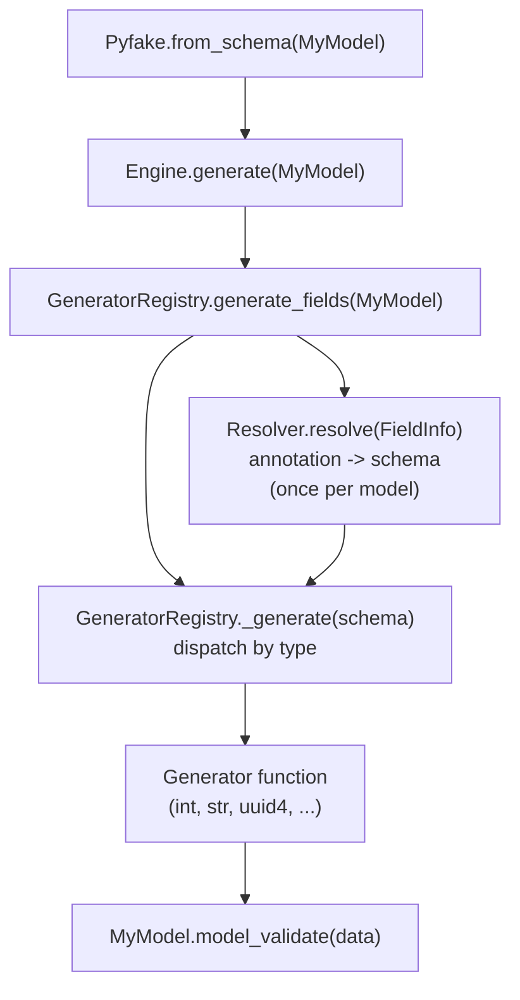

# How It Works

`pyfake` inspects a Pydantic model's field metadata at runtime and produces realistic fake values that satisfy every declared constraint — bounds, length, format, defaults, and more.

## The Pipeline


<center>

</center>

---

## Components

### `Pyfake` — Public API

The `Pyfake` class is the user-facing entry point. It holds a [`Context`](#context-shared-random-state) and an [`Engine`](#engine-orchestration), both bound to the model you pass in.

```python
from pyfake import Pyfake

# Class method shortcut — no need to instantiate manually
result = Pyfake.from_schema(MyModel, num=5, seed=42)

# Or instantiate first for repeated generation
fake = Pyfake(MyModel, seed=42)
fake.generate(num=3)
```

The optional `seed` parameter is forwarded to the `Context`, making generation fully deterministic and reproducible.

When `as_dict=True` (the default), instances are returned as plain `dict`s via `.model_dump()`. Set `as_dict=False` to get back the actual Pydantic model instances. `num=1` returns a single instance; any other `num` returns a list (`num=0` gives `[]`).

The `fake` object (`from pyfake import fake`) is a thin wrapper around `Pyfake`. `fake.seed(n)` returns a `Fake` that keeps one `Context` across calls, so successive calls continue the same seeded stream.

---

### `Engine` — Orchestration

`Engine` knows nothing about types or constraints. It asks the `GeneratorRegistry` for a value for every field of the model, and the registry walks `model.model_fields`.

```python
# Internally, the registry does roughly this:
if MyModel not in cache:
    cache[MyModel] = {name: Resolver(info).resolve()["schema"] for name, info in MyModel.model_fields.items()}
return {name: registry._generate(schema) for name, schema in cache[MyModel].items()}
```

Each model's fields are resolved once and reused for every row. The resulting `data` dict is passed to `MyModel.model_validate(data, by_name=True)`, so Pydantic validates the output before it is returned to you. `by_name=True` lets fields with an alias be filled in by their field name.

---

### `Resolver` — Type Resolution

`Resolver` takes a `FieldInfo` object and converts its annotation into a **schema dict** — a plain Python dict that encodes everything the generators need to know.

It resolves annotations recursively, handling:

| Annotation form| Resolved as|
|-|-|
| `int`, `str`, `float`, `bool`, `uuid.UUID`, `EmailStr`, ... | primitive schema node|
| `Optional[T]` / `T`| `None`                                                      | `union` node with `nullable=True` |
| `Union[A, B]`| `union` node with multiple variants                        |
| `List[T]`, `Set[T]`, `FrozenSet[T]`| container node with an `items` sub-schema|
| `Sequence[T]`, `Iterable[T]`, `deque[T]`, ...| `list` node|
| `Tuple[A, B]` / `Tuple[T, ...]`| fixed or variable-length tuple                             |
| `Dict[K, V]`, `Mapping[K, V]`, `Counter[K]`, ...| dict node with `keys` and `values` sub-schemas|
| `Literal["a", "b"]`| literal node with a `values` list|
| `Enum` subclasses| enum node|
| Nested `BaseModel`| model node; its fields are resolved lazily by the registry |
| `Annotated[T, Field(...)]`| delegates to the inner type, merging constraints           |

Constraints extracted from `Field(...)` — like `ge`, `lt`, `min_length`, `max_length`, `multiple_of`, `decimal_places`, `max_digits`, `pattern`, `format` — are collected into a `GeneratorArgs` instance and attached to the schema node. Constrained types (`conint(...)`, `constr(...)`, `StringConstraints(...)`, `annotated_types.Interval(...)`) group several constraints together; the resolver unpacks them.

#### Schema node shape

Each resolved node is a dict with at minimum a `type` key and a `generator_args` key. Complex types add their own keys:

```python
# primitive
{"type": str, "generator_args": GeneratorArgs(min_length=3, max_length=20)}

# union / Optional
{"type": "union", "nullable": True, "variants": [...]}

# list
{"type": list, "items": {...}, "generator_args": GeneratorArgs()}

# nested model (fields are resolved when the model is generated)
{"type": "model", "model": Address, "generator_args": GeneratorArgs()}
```

---

### `GeneratorRegistry` — Dispatch

The registry receives a schema node and routes it to the correct generator function. The dispatch order is:

1. **Default shortcut** — if `generator_args.default` is set, return it immediately.
2. **Union** — pick a random variant; occasionally return `None` for nullable unions.
3. **Literal / Enum** — pick a random value from the declared set.
4. **Container types** (`list`, `set`, `frozenset`, `dict`, `tuple`) — generate the appropriate number of items by recursing into sub-schemas. Sets and dict keys are generated until they are distinct.
5. **Nested model** — generate its fields and build the model with `model_validate`.
6. **Format-based dispatch** — if `generator_args.format` is set (e.g. `"uuid4"`, `"date-time"`, `"email"`), look up the matching generator by that string key.
7. **URL types** — `HttpUrl`, `PostgresDsn`, ... carry their allowed schemes, which are passed to the URL generator.
8. **Primitive type dispatch** — map the Python type (or a supported base class) to a generator via the `_type_map` table.

Below are the built-in type and format mappings:

| Key               | Generator                           |
| ----------------- | ----------------------------------- |
| `integer`         | `generate_int`                      |
| `number`          | `generate_float`                    |
| `decimal`         | `generate_decimal`                  |
| `string`          | `generate_str`                      |
| `bool`            | `generate_bool`                     |
| `uuid` / `uuid4`  | `generate_uuid4`                    |
| `uuid1` … `uuid8` | `generate_uuid1` … `generate_uuid8` |
| `date`            | `generate_date`                     |
| `date-time`       | `generate_datetime`                 |
| `time`            | `generate_time`                     |

The full list, including emails, URLs, IP addresses and relative dates, is in the [Internals](internals.md#type-and-format-map) reference.

If no match is found after all steps, the registry raises `GeneratorNotFound` with the path of the field (e.g. `User.address.location`).

---

### `Context` — Shared Random State

Every generator receives a shared `Context` instance. It carries a single `random.Random` object, which all generators use instead of the global `random` module, and a fixed `now` (the start of the current UTC day) for values relative to the current time.

```python
# Unseeded — different output each run
fake = Pyfake(MyModel)

# Seeded — identical output every run
fake = Pyfake(MyModel, seed=123)
```

Passing a seed through the `Pyfake` constructor guarantees that all fields, across all generated instances, use the same seeded random stream — making test fixtures fully reproducible. UUIDs are included: every UUID version draws from the same stream.
