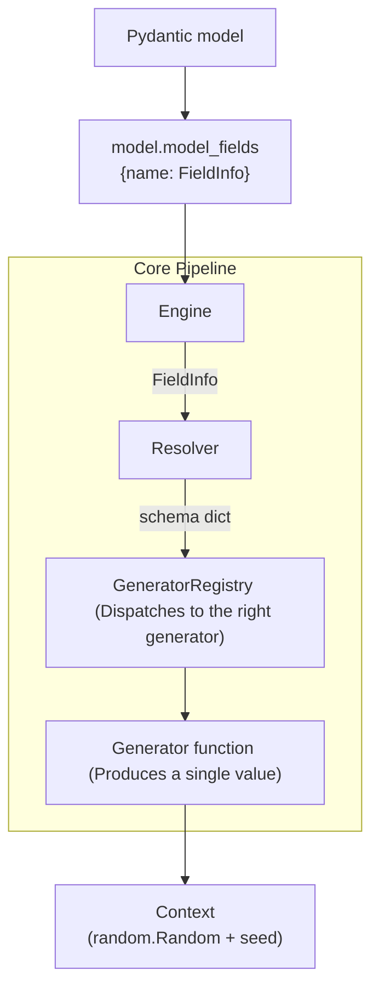

# Internals

This page documents the internal architecture of `pyfake` — how the pieces fit together and what responsibilities each component holds.

For a narrative walkthrough of a single generation call, see [How It Works](how-it-works.md).

---

## Architecture Overview

<!-- ```
Pydantic model
      │
      │  model.model_fields  ->  {name: FieldInfo}
      ▼
   Engine          — iterates fields, collects results
      │
      │  FieldInfo  ->  Resolver
      ▼
   Resolver        — converts annotation + constraints -> schema dict
      │
      │  schema dict  ->  GeneratorRegistry
      ▼
   GeneratorRegistry  — dispatches to the right generator
      │
      ▼
   Generator function  — produces a single value
      │
      ▼
   Context         — shared random.Random (and optional seed)
``` -->

<center>

</center>

---

## `Context`

```python
class Context:
    def __init__(self, seed: Optional[int] = None, now: Optional[datetime] = None):
        self.seed = seed
        self.random = random.Random(seed)
        # Defaults to the start of the current UTC day
        self.now = now or datetime.now(timezone.utc).replace(
            hour=0, minute=0, second=0, microsecond=0
        )
```

`Context` is the only place where randomness lives. Every generator receives it and uses `context.random` exclusively, so the entire generation run is controlled by a single source of entropy. Passing a `seed` makes output fully deterministic.

`context.now` is the reference point for values relative to the current time: `PastDate`, `FutureDate`, `PastDatetime`, `FutureDatetime` and the timestamps in time-based UUIDs (v1, v6, v7). Rounding it down to the start of the day keeps seeded output stable for the whole day.

`Timeseries` is the exception: it uses its own NumPy generator, `numpy.random.default_rng(seed)`.

---

## `Resolver`

`Resolver` takes a `FieldInfo` and returns a schema dict. It works by recursively inspecting the annotation using `typing.get_origin` and `typing.get_args`, handling each structural form before bottoming out at a primitive type.

### Constraint extraction

Field constraints come from two places:

- **`FieldInfo` metadata** (e.g. `Field(ge=0, lt=100)`) — parsed at the root level.
- **`Annotated` metadata** (e.g. `Annotated[int, Field(min_length=3)]`, `Annotated[int, Gt(0)]`) — parsed and merged as the recursion descends.

Both are collected into a `GeneratorArgs` instance. Grouped metadata — `conint(...)`, `constr(...)`, `StringConstraints(...)`, `annotated_types.Interval(...)` — is unpacked into its individual constraints first, and the `None` placeholders pydantic leaves for unset options are skipped. When the resolved node is a `union`, the constraints are pushed into each variant rather than the union wrapper itself.

`json_schema_extra` is read only when it is a dict (for `format` and `timezone`); a callable `json_schema_extra` only customises the JSON schema and is ignored.

Nested models are not resolved eagerly. The resolver returns a `model` node, and the registry resolves the model's fields the first time it generates one. This is what lets self-referencing models work.

### `GeneratorArgs` fields

`GeneratorArgs` is a plain dataclass, so bounds can hold any comparable value (numbers, `Decimal`s, dates, times, timedeltas).

| Field            | Applies to                            | Description                                 |
| ---------------- | ------------------------------------- | ------------------------------------------- |
| `lt`             | numbers, dates, datetimes, times, timedeltas | exclusive upper bound                |
| `gt`             | numbers, dates, datetimes, times, timedeltas | exclusive lower bound                |
| `le`             | numbers, dates, datetimes, times, timedeltas | inclusive upper bound                |
| `ge`             | numbers, dates, datetimes, times, timedeltas | inclusive lower bound                |
| `min_length`     | `str`, `bytes`, `list`, `set`, `tuple`, `dict` | minimum length                     |
| `max_length`     | `str`, `bytes`, `list`, `set`, `tuple`, `dict` | maximum length                     |
| `multiple_of`    | `int`, `float`, `Decimal`             | value must be a multiple                    |
| `decimal_places` | `float`, `Decimal`                    | number of decimal places                    |
| `max_digits`     | `Decimal`                             | maximum number of digits in total           |
| `pattern`        | `str`                                 | regex the value must match                  |
| `format`         | any                                   | generator key, e.g. `"uuid4"`, `"date-time"`, `"email"` |
| `timezone`       | `datetime`                            | `tzinfo` stamped on (or converted to) the result |
| `default`        | any                                   | return this value directly, skip generation |
| `examples`       | any                                   | reserved; not used by generators            |

---

## `GeneratorRegistry`

The registry owns the mapping from type keys and format strings to generator callables. It also contains the dispatch logic in `_generate(schema, path)`.

### Type and format map

Keys match the JSON Schema `format` names where one exists, so any of them can be picked with `Field(json_schema_extra={"format": ...})`.

| Key | Types | Generator |
| --- | --- | --- |
| `integer` | `int` | `generate_int` |
| `number` | `float` | `generate_float` |
| `decimal` | `Decimal` | `generate_decimal` |
| `string` | `str`, `SecretStr` | `generate_str` |
| `bool` | `bool` | `generate_bool` |
| `binary` | `bytes`, `SecretBytes` | `generate_bytes` |
| `any` | `Any`, `object` | `generate_any` |
| `null` | `None` | `generate_none` |
| `uuid` / `uuid4` | `uuid.UUID` | `generate_uuid4` |
| `uuid1` … `uuid8` | `pydantic.UUID1` … `UUID8` | `generate_uuid1` … `generate_uuid8` |
| `date` | `date` | `generate_date` |
| `past-date` / `future-date` | `PastDate` / `FutureDate` | `generate_past_date` / `generate_future_date` |
| `date-time` | `datetime`, `NaiveDatetime` | `generate_datetime` |
| `aware-date-time` | `AwareDatetime` | `generate_aware_datetime` |
| `past-date-time` / `future-date-time` | `PastDatetime` / `FutureDatetime` | `generate_past_datetime` / `generate_future_datetime` |
| `time` | `time` | `generate_time` |
| `duration` | `timedelta` | `generate_timedelta` |
| `email` | `EmailStr` | `generate_email` |
| `name-email` | `NameEmail` | `generate_name_email` |
| `uri` | `AnyUrl`, `HttpUrl`, DSN types, ... | `generate_url` |
| `ipv4` / `ipv6` / `ipvanyaddress` | `IPv4Address` / `IPv6Address` / `IPvAnyAddress` | `generate_ip_address` |
| `ipv4network` / `ipv6network` / `ipvanynetwork` | `IPv4Network` / `IPv6Network` / `IPvAnyNetwork` | `generate_ip_network` |
| `ipv4interface` / `ipv6interface` / `ipvanyinterface` | `IPv4Interface` / `IPv6Interface` / `IPvAnyInterface` | `generate_ip_interface` |

Subclasses of a mapped type use their base class's generator, e.g. pydantic's `ByteSize` (an `int`).

### Dispatch order

`_generate` checks in this order and returns at the first match:

1. `generator_args.default is not None` -> return the default directly.
2. `type == "union"` -> randomly pick a variant; ~20% chance to return `None` for nullable unions.
3. `type == "literal"` -> `random.choice(values)`.
4. `type == "enum"` -> `random.choice(values)`.
5. `type in (list, set, frozenset, dict, tuple)` -> generate the correct number of items by recursing. Sets and dict keys are generated until they are distinct.
6. `type == "model"` -> generate the model's fields (resolved once and cached) and build it with `model_validate(data, by_name=True)`.
7. `generator_args.format` is set and matches a key in `_generators` -> call that generator.
8. `type` has pydantic `UrlConstraints` (URL and DSN types) -> call `generate_url` with the allowed schemes.
9. `type` (or one of its base classes) is in `_type_map` -> call the mapped generator.
10. Fall through -> raise `GeneratorNotFound(type, path)`.

### Container lengths

Lengths come from `min_length` / `max_length`, defaulting to `1..5`. A missing bound falls back to its default; when only `min_length` is given and it is above `5`, the range becomes `min_length..min_length + 4`. Sets and dicts whose item type has only a few possible values (`bool`, `Literal`, `Enum`) are capped at that number, and raise `InvalidConstraints` when `min_length` is higher.

### Self-referencing models

The registry keeps a stack of the models it is generating. Once a model appears `MAX_DEPTH` (3) times on the current path, the registry stops adding nested items: nullable unions become `None`, and containers get `min_length` items (empty by default). If a model refers to itself through fields that can't be left empty, the stack keeps growing until a hard limit, and the registry raises `InvalidConstraints` naming the model.

---

## `Engine`

`Engine` is intentionally thin. It calls `registry.generate_fields(model)`, which resolves `model.model_fields` (once per model) and generates a value for each field. The dict is returned to `Pyfake`, which uses it to construct a validated model instance with `model_validate(data, by_name=True)`.

---

## `Pyfake`

`Pyfake` is the public surface. It wires together `Context`, `Engine`, and the model class, and handles the `num` / `as_dict` output options. `num=1` returns one instance and any other `num` returns a list, so `num=0` returns `[]`.

```python
# Functional (class method)
Pyfake.from_schema(MyModel, num=10, seed=0, as_dict=True)

# Object (useful when generating repeatedly from the same model)
fake = Pyfake(MyModel, seed=0)
fake.generate(num=5)
fake.generate(num=5)  # same seed -> different values (stream continues)
```

!!! note
      Each `Pyfake` instance maintains its own `Context`. The random stream advances with each call to `generate`, so successive calls on the same instance produce different (but still deterministic) results.

`Fake` (the class behind `from pyfake import fake`) builds a `Pyfake` for every call. A `Fake` created with a seed (`Fake(seed=42)` or `fake.seed(42)`) passes the same `Context` to each of them, so its calls continue one seeded stream. A `seed=` passed to a single call gets a fresh `Context`.
